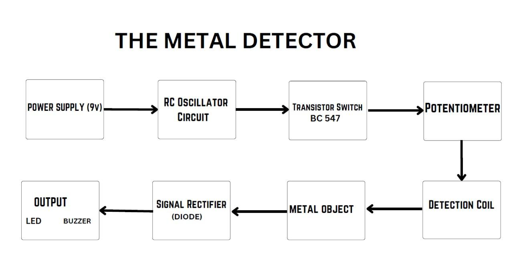
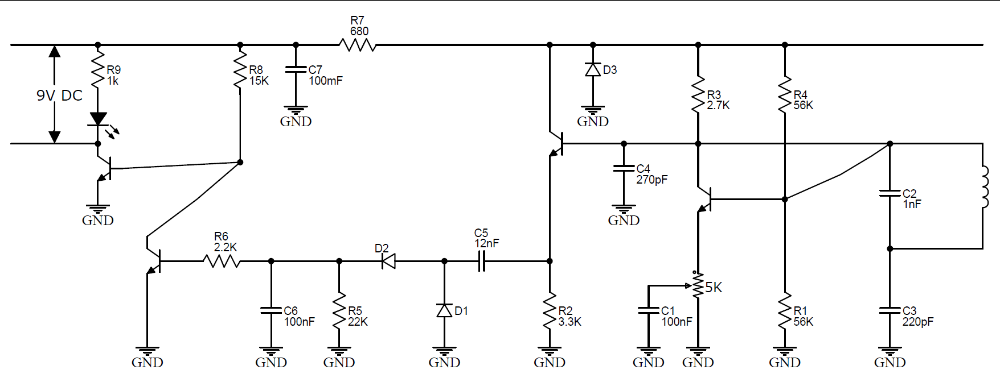
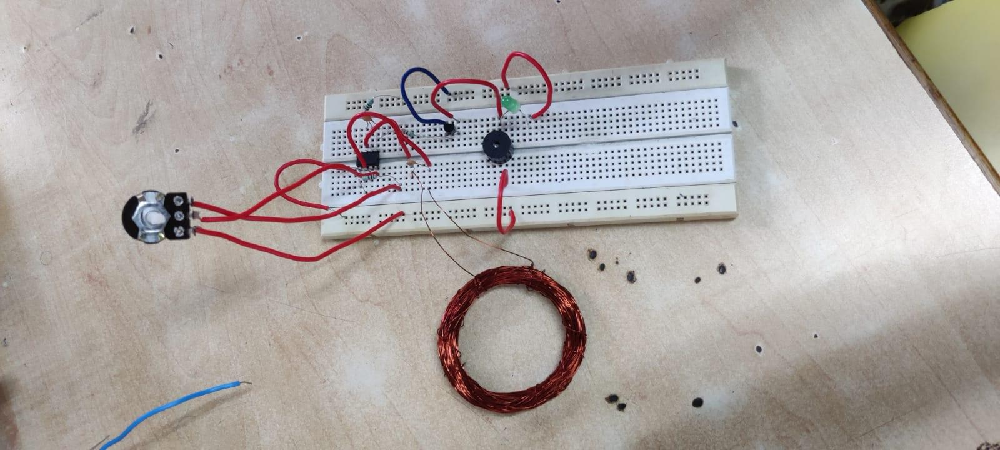
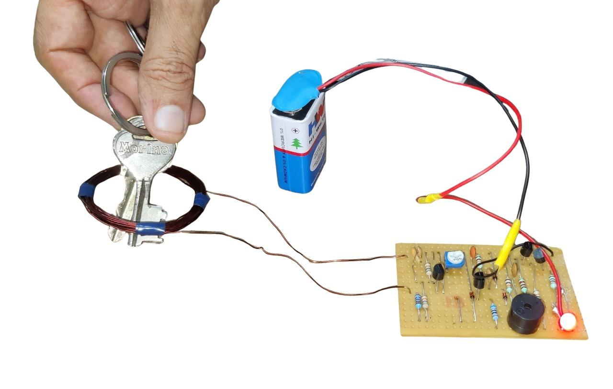
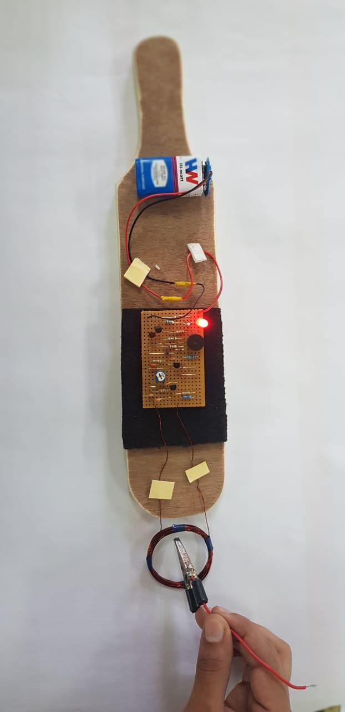

# Metal Detector

A portable, discrete analog metal detector designed and built using electromagnetic induction and a high-frequency LC tank oscillator circuit. Developed as an academic Mini Project (1A) in Semester III of the Electronics & Telecommunication Engineering (EXTC) program at Don Bosco Institute of Technology, Mumbai.

---

## 1. Project Overview

This project demonstrates non-contact detection of metallic objects using a custom-wound air-core copper search coil and a four-transistor (`BC547B`) analog signal processing chain. When a metallic object enters the alternating magnetic field generated by the search coil, induced eddy currents shift the resonant characteristics of the LC tank. The circuit rectifies, filters, and amplifies this disturbance to trigger simultaneous visual (Red LED) and audio (piezo buzzer) alerts.

---

## 2. Objectives

- Design and construct a functional metal detector using discrete analog components.
- Study LC tank resonance, eddy current induction, and transistor-based signal amplification/switching.
- Implement adjustable sensitivity calibration to minimize false positives during handheld operation.
- Validate circuit stability across breadboard and soldered General Purpose (GP) perfboard implementations.

---

## 3. Hardware Components

| Component | Specification | Quantity | Role in Circuit |
| :--- | :--- | :---: | :--- |
| **Search Coil** | 24 AWG enameled copper wire, ~40–50 turns, ~5 cm diameter | 1 | Sensing element generating the alternating magnetic field |
| **NPN Transistors** | `BC547B` (TO-92 package) | 4 | LC oscillator driver, buffer stage, and two-stage output switch |
| **Diodes** | General-purpose signal/rectifier diodes (`D1`, `D2`, `D3`) | 3 | Signal rectification and voltage clamping/protection |
| **Potentiometer** | `5 kΩ` trimmer preset | 1 | Oscillator bias and detection sensitivity calibration |
| **Resistors** | `680 Ω`, `1 kΩ`, `2.2 kΩ`, `2.7 kΩ`, `3.3 kΩ`, `15 kΩ`, `22 kΩ`, `56 kΩ` (×2) | 9 | Biasing, current limiting, and RC filtering |
| **Capacitors** | `220 pF`, `270 pF`, `1 nF`, `12 nF`, `100 nF` (×2), `100 µF` | 7 | LC tank resonance, AC coupling, envelope filtering, and supply decoupling |
| **Indicators** | Red LED + Piezo Buzzer | 1 each | Visual and audible metal detection alert |
| **Power Supply** | 9V DC Battery | 1 | Portable power source |
| **Prototyping Board** | General Purpose (GP) Perfboard + Wooden Handheld Mount | 1 | Permanent soldered circuit assembly and ergonomic testing |

---

## 4. Software and Tools Used

- **KiCad EDA:** Used during design exploration for schematic capture and PCB layout concepts.
- **Hardware Prototyping & Soldering:** Breadboard testing followed by permanent point-to-point soldering on a General Purpose (GP) perfboard.

---

## 5. System Architecture & Working Principle

### Block Diagram

### Circuit Schematic

### Stage-by-Stage Operation

1. **LC Tank & Oscillator Stage:** The 40–50 turn copper search coil forms an LC resonant tank with capacitors `C2` (`1 nF`) and `C3` (`220 pF`), driven by the first `BC547B` transistor. The `5 kΩ` preset adjusts the emitter bias to set the oscillation threshold just on the edge of stability for maximum sensitivity.
2. **Buffer & Coupling Stage:** A second `BC547B` stage isolates the resonant tank from downstream loading, passing the high-frequency AC signal through coupling capacitor `C5` (`12 nF`).
3. **Rectification & Envelope Filtering:** Diodes `D1` and `D2` rectify and clamp the coupled signal, while `R5` (`22 kΩ`) and `C6` (`100 nF`) smooth the envelope into a DC control level.
4. **Detection & Alert Output Stage:** When metal approaches the coil, eddy currents alter the coil's inductance and dampen/shift the oscillation. This change shifts the rectified DC level at the base of the third `BC547B`, switching the final `BC547B` output stage to illuminate the Red LED and sound the buzzer.

---

## 6. Prototyping & Hardware Results

### Breadboard vs. General Purpose (GP) Board Findings

- **Breadboard Testing:** Initial assembly on a solderless breadboard failed to maintain stable detection because the oscillator operated in the **MHz frequency range**, where stray inter-row capacitance of the breadboard disrupted the LC tank.
- **Soldered GP Board Prototype:** Transferring the circuit onto a soldered General Purpose (GP) board eliminated parasitic breadboard capacitance, yielding stable oscillation and reliable metal detection.

| Breadboard Test Setup | Soldered GP Board Test | Final Handheld Prototype |
| :---: | :---: | :---: |
|  |  |  |

---

## 7. Key Features

- **Discrete Analog Design:** Built entirely with off-the-shelf `BC547B` transistors and passive components without relying on specialized metal-detector ICs.
- **Adjustable Sensitivity:** On-board `5 kΩ` trimmer potentiometer allows fine threshold tuning for different metallic targets.
- **Dual Alert Feedback:** Simultaneous Red LED illumination and buzzer tone upon target detection.
- **Battery-Powered Portability:** Operates on a single 9V DC battery mounted on a lightweight handheld frame.

---

## 8. Applications

- Basic security screening for concealed metallic objects.
- Locating nails, screws, or metallic debris in woodworking and workshop environments.
- Educational demonstrations of electromagnetic induction, eddy currents, and LC oscillators.

---

## 9. Future Scope

- **Custom Printed Circuit Board (PCB):** Fabricate a compact two-layer PCB in KiCad to further reduce stray inductance and improve mechanical durability.
- **Ferrous vs. Non-Ferrous Discrimination:** Add a phase-comparator or beat-frequency oscillator (BFO) stage to distinguish between magnetic and non-magnetic metals.
- **Shielded Search Head:** Enclose the search coil in a Faraday-shielded housing to reduce false triggers caused by capacitive ground coupling.

---

## 10. Project Report

- **Full Academic Report:** [Metal_Detector_Report_Final.pdf](./Metal_Detector_Report_Final.pdf)

---

## 11. Academic Details

- **Project Title:** Metal Detector
- **Course:** Mini Project 1A — Semester III (Second Year of Engineering, AY 2024–2025)
- **Department:** Electronics & Telecommunication Engineering (EXTC)
- **Institution:** Don Bosco Institute of Technology (DBIT), Kurla, Mumbai (Affiliated to the University of Mumbai)
- **Project Group (Group No. 8):**
  - **Aayush Jangam** (Roll No. 49)
  - **Vinayak Yadav** (Roll No. 47)
  - **Atif Siddique** (Roll No. 44)
  - **Harsh Rai** (Roll No. 36)
- **Project Supervisors:** Ms. Freda Venessa Carvalho & Mr. Ankur Ganorkar
